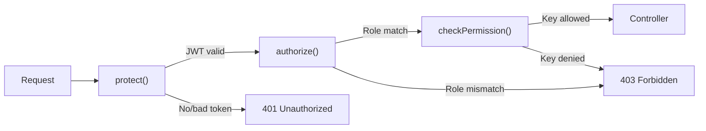

# VINJACK OLD REF — Complete Codebase Analysis & Summary

---

## 1. Project Identity

| Field | Value |
|---|---|
| **Project** | Web-Based Sales & Inventory Management System for VinJack Motorworks |
| **Client** | VinJack Motorworks — motorcycle repair & maintenance shop, Marikina City |
| **Origin** | IT Capstone Project, STI College Marikina (© 2025) |
| **Stack** | **MERN** — MongoDB, Express.js, React 19, Node.js |
| **Architecture** | Three-tier client–server with real-time WebSocket overlay |
| **License** | Proprietary / Academic |

---

## 2. Repository Structure Overview

```
VINJACK OLD REF/
├── README.md                    (791 lines, comprehensive documentation)
├── LICENSE.txt
├── package.json                 (root: multer dependency only)
│
├── server/                      ← Node.js + Express Backend
│   ├── index.js                 (154 lines — app bootstrap, Socket.IO, graceful shutdown)
│   ├── config/
│   │   └── db.js                (Mongoose connection)
│   ├── models/                  (20 Mongoose schema files)
│   ├── controllers/             (22 controller files, ~166 KB total)
│   ├── routes/                  (22 Express router files)
│   ├── middleware/               (3 files: auth, upload, backup-upload)
│   ├── utils/                   (8 utility modules)
│   ├── jobs/
│   │   └── cronJobs.js          (scheduled email + backup jobs)
│   ├── uploads/                 (receipts & agreements file storage)
│   └── __tests__/               (35 Jest test suites)
│
└── client/                      ← React 19 Frontend (Create React App)
    ├── src/
    │   ├── App.js               (129 lines — routing + providers)
    │   ├── api/                 (15 Axios API wrapper modules)
    │   ├── context/             (3 React Contexts)
    │   ├── components/          (35 reusable components + 3 report sub-components)
    │   └── pages/               (23 page-level components, ~460 KB total)
    └── public/
        └── assets/              (logo, backgrounds, intro video)
```

---

## 3. File Count Inventory

| Layer | Category | Count | Total Size |
|---|---|---|---|
| **Backend** | Mongoose Models | **20** files | ~25 KB |
| | Controllers | **22** files | ~166 KB |
| | Route Files | **22** files | ~20 KB |
| | Middleware | **3** files | ~8 KB |
| | Utility Services | **8** files | ~32 KB |
| | Cron Jobs | **1** file | ~9 KB |
| | Tests | **35** suites | — |
| **Frontend** | Page Components | **23** files | ~460 KB |
| | Reusable Components | **38** files (35 + 3 report) | ~240 KB |
| | API Modules | **15** files | ~16 KB |
| | Context Providers | **3** files | ~12 KB |
| **Total** | | **~190 source files** | **~988 KB** |

---

## 4. Technology Stack Detail

### Backend ([server/](file:///d:/WEB%20System/VINJACK%20OLD%20REF/server))

| Technology | Version | Purpose |
|---|---|---|
| Node.js | ≥ 14 | Runtime |
| Express.js | 4.x | REST API framework |
| MongoDB | 6.x (Community/Atlas) | NoSQL database |
| Mongoose | — | MongoDB ODM |
| JWT (`jsonwebtoken`) | — | Authentication tokens |
| `bcryptjs` | — | Password hashing |
| Socket.IO | — | Real-time WebSocket notifications |
| Nodemailer | — | Email alerts (Gmail SMTP) |
| `node-cron` | — | Scheduled jobs |
| Multer | 2.x | File uploads |
| `@google-cloud/storage` | — | GCS backup |
| `date-fns` / `date-fns-tz` | — | Timezone-aware date helpers |

### Frontend ([client/](file:///d:/WEB%20System/VINJACK%20OLD%20REF/client))

| Technology | Version | Purpose |
|---|---|---|
| React | 19 | UI library |
| React Router | 7 | Client-side routing |
| Material UI (MUI) | v7 | UI component framework |
| MUI X Data Grid | — | Data tables |
| Emotion | — | CSS-in-JS (MUI styling engine) |
| Framer Motion | — | Animations |
| Axios | — | HTTP client |
| Socket.IO Client | — | Real-time transport |
| Chart.js + react-chartjs-2 | — | Dashboard charts |
| jsPDF + jspdf-autotable | — | PDF report generation |
| react-to-print | — | Receipt printing |
| react-toastify | — | Toast notifications |
| dayjs / date-fns | — | Date formatting |

---

## 5. Data Model Inventory (20 Mongoose Collections)

### Core Business Entities

| Model | File | Key Fields | Relationships |
|---|---|---|---|
| [**Product**](file:///d:/WEB%20System/VINJACK%20OLD%20REF/server/models/productModel.js) | 65 lines | `itemCode` (unique), `name`, `price`, `quantity`, `consignedStock`, `maxStock`, `stockStatus`, `isSerialized` | → Category, → Brand, embedded `supplierCosts[]` (→ Supplier), embedded `serializedItems[]` |
| [**Sale**](file:///d:/WEB%20System/VINJACK%20OLD%20REF/server/models/saleModel.js) | 80 lines | `totalAmount`, `isManualEntry`, `customerReceiptImage` | → User (recordedBy), → Customer, → Motorcycle, embedded `items[]` (→ Product), embedded `services[]` (→ Service) |
| [**PurchaseOrder**](file:///d:/WEB%20System/VINJACK%20OLD%20REF/server/models/purchaseOrderModel.js) | 88 lines | `poNumber` (unique), `totalAmount`, `poType`, `consignmentMethod`, `status` (7 states), `supplierResponseToken` | → Supplier, embedded `items[]` (→ Product), embedded `history[]` |
| [**Delivery**](file:///d:/WEB%20System/VINJACK%20OLD%20REF/server/models/deliveryModel.js) | 57 lines | `deliveryDate`, `deliveryType`, `totalCost` | → Supplier, → PurchaseOrder (optional), → User, embedded `productsReceived[]` (→ Product) |
| [**Return**](file:///d:/WEB%20System/VINJACK%20OLD%20REF/server/models/returnModel.js) | 61 lines | `reason`, `outcome` (4 types), `totalRefundAmount` | → Sale, → User, embedded `itemsReturned[]` (→ Product), embedded `servicesReturned[]` (→ Service) |
| [**SupplierReturn**](file:///d:/WEB%20System/VINJACK%20OLD%20REF/server/models/supplierReturnModel.js) | 62 lines | `returnDate`, `originalPurchaseType` (refPath) | → Supplier, → User, dynamic → PurchaseOrder or Delivery, embedded `productsReturned[]` (→ Product) |
| [**ConsignmentPayable**](file:///d:/WEB%20System/VINJACK%20OLD%20REF/server/models/consignmentPayableModel.js) | 51 lines | `quantitySold`, `amountOwed`, `status` (Owed/Paid) | → Sale, → Product, → Supplier, → User |

### Supporting Entities

| Model | File | Key Fields |
|---|---|---|
| [**User**](file:///d:/WEB%20System/VINJACK%20OLD%20REF/server/models/userModel.js) | 82 lines | `fullName`, `username` (unique), `email` (unique), `password` (bcrypt), `role` (3 roles), `mustChangePassword`, `failed_attempts`, `emailSettings{}`, `dashboardPreferences{}`, `pendingChanges{}` |
| [**Customer**](file:///d:/WEB%20System/VINJACK%20OLD%20REF/server/models/customerModel.js) | 37 lines | `name`, `email` (unique sparse), `phone`, `address`, `motorcycles[]` (→ Motorcycle) |
| [**Motorcycle**](file:///d:/WEB%20System/VINJACK%20OLD%20REF/server/models/motorcycleModel.js) | 45 lines | `make`, `model`, `year`, `color`, `plateNumber` (unique sparse), `vin` (unique sparse), → Customer |
| [**Supplier**](file:///d:/WEB%20System/VINJACK%20OLD%20REF/server/models/supplierModel.js) | 52 lines | `name` (unique), `email`, `contactPerson`, `status` (3 states), `defaultPaymentTerms` (Cash/Consignment/Terms) |
| [**Service**](file:///d:/WEB%20System/VINJACK%20OLD%20REF/server/models/serviceModel.js) | 27 lines | `name` (unique), `description`, `charge`, `status` |
| [**Category**](file:///d:/WEB%20System/VINJACK%20OLD%20REF/server/models/categoryModel.js) | 8 lines | `name` (unique), `description` |
| [**Brand**](file:///d:/WEB%20System/VINJACK%20OLD%20REF/server/models/brandModel.js) | 7 lines | `name` (unique) |

### System / Audit Entities

| Model | File | Purpose |
|---|---|---|
| [**Movement**](file:///d:/WEB%20System/VINJACK%20OLD%20REF/server/models/movementModel.js) | 21 lines | Stock ledger — signed `quantityChange`, `stockBefore`/`stockAfter`, 5 movement types |
| [**AuditLog**](file:///d:/WEB%20System/VINJACK%20OLD%20REF/server/models/auditLogModel.js) | 75 lines | Immutable action log — **40+ audit action types** covering CRUD, auth, backup, etc. |
| [**Notification**](file:///d:/WEB%20System/VINJACK%20OLD%20REF/server/models/notificationModel.js) | 30 lines | Per-user notifications — 5 types (LOW_STOCK, CRITICAL_STOCK, OUT_OF_STOCK, USER_ACTION, REQUEST_STATUS) |
| [**Setting**](file:///d:/WEB%20System/VINJACK%20OLD%20REF/server/models/settingModel.js) | 18 lines | Key-value system settings store |
| [**Counter**](file:///d:/WEB%20System/VINJACK%20OLD%20REF/server/models/counterModel.js) | 9 lines | Auto-increment sequence generator (for PO numbers) |
| [**RolePermission** + **AllPermissions**](file:///d:/WEB%20System/VINJACK%20OLD%20REF/server/models/permissionModel.js) | 72 lines | RBAC — master permission list + per-role allowed keys |

---

## 6. API Endpoint Map (~85 Endpoints)

| Resource | Base Route | Methods | Controller | Lines |
|---|---|---|---|---|
| **Users / Auth** | `/api/users` | `POST /login`, `POST /demo-login`, `GET /me`, `PUT /force-change-password`, `POST /logout`, full CRUD | [userController.js](file:///d:/WEB%20System/VINJACK%20OLD%20REF/server/controllers/userController.js) | ~490 |
| **Products** | `/api/products` | CRUD, `GET /low-stock`, stock warnings | [productController.js](file:///d:/WEB%20System/VINJACK%20OLD%20REF/server/controllers/productController.js) | ~420 |
| **Categories** | `/api/categories` | CRUD | [categoryController.js](file:///d:/WEB%20System/VINJACK%20OLD%20REF/server/controllers/categoryController.js) | ~75 |
| **Brands** | `/api/brands` | CRUD | [brandController.js](file:///d:/WEB%20System/VINJACK%20OLD%20REF/server/controllers/brandController.js) | ~70 |
| **Sales (POS)** | `/api/sales` | Create, List, Get, Search, Receipt upload | [saleController.js](file:///d:/WEB%20System/VINJACK%20OLD%20REF/server/controllers/saleController.js) | 295 |
| **Services** | `/api/services` | CRUD | [serviceController.js](file:///d:/WEB%20System/VINJACK%20OLD%20REF/server/controllers/serviceController.js) | ~80 |
| **Customers** | `/api/customers` | CRUD + motorcycle linkage | [customerController.js](file:///d:/WEB%20System/VINJACK%20OLD%20REF/server/controllers/customerController.js) | ~110 |
| **Motorcycles** | `/api/motorcycles` | CRUD | [motorcycleController.js](file:///d:/WEB%20System/VINJACK%20OLD%20REF/server/controllers/motorcycleController.js) | ~180 |
| **Suppliers** | `/api/suppliers` | CRUD + approval flow | [supplierController.js](file:///d:/WEB%20System/VINJACK%20OLD%20REF/server/controllers/supplierController.js) | ~260 |
| **Purchase Orders** | `/api/purchase-orders` | Create, Send, Approve, Receive, Full lifecycle | [purchaseOrderController.js](file:///d:/WEB%20System/VINJACK%20OLD%20REF/server/controllers/purchaseOrderController.js) | **~780** (largest) |
| **Deliveries** | `/api/deliveries` | Record deliveries | [deliveryController.js](file:///d:/WEB%20System/VINJACK%20OLD%20REF/server/controllers/deliveryController.js) | ~150 |
| **Returns** | `/api/returns` | Customer returns | [returnController.js](file:///d:/WEB%20System/VINJACK%20OLD%20REF/server/controllers/returnController.js) | ~260 |
| **Supplier Returns** | `/api/supplier-returns` | Returns to suppliers | [supplierReturnController.js](file:///d:/WEB%20System/VINJACK%20OLD%20REF/server/controllers/supplierReturnController.js) | ~140 |
| **Consignment** | `/api/consignment` | Payables / payout tracking | [consignmentController.js](file:///d:/WEB%20System/VINJACK%20OLD%20REF/server/controllers/consignmentController.js) | ~85 |
| **Movements** | `/api/movements` | Stock ledger queries | [movementController.js](file:///d:/WEB%20System/VINJACK%20OLD%20REF/server/controllers/movementController.js) | ~20 |
| **Adjustments** | `/api/adjustments` | Manual stock adjustments | [adjustmentController.js](file:///d:/WEB%20System/VINJACK%20OLD%20REF/server/controllers/adjustmentController.js) | ~80 |
| **Reports** | `/api/reports` | Dashboard summary, sales report, returns report, trends, recent activity, low-stock, pending POs | [reportController.js](file:///d:/WEB%20System/VINJACK%20OLD%20REF/server/controllers/reportController.js) | 435 |
| **Notifications** | `/api/notifications` | List + mark-as-read | [notificationController.js](file:///d:/WEB%20System/VINJACK%20OLD%20REF/server/controllers/notificationController.js) | ~30 |
| **Audit Logs** | `/api/audit-logs` | Immutable log viewer | [auditLogController.js](file:///d:/WEB%20System/VINJACK%20OLD%20REF/server/controllers/auditLogController.js) | ~40 |
| **Permissions** | `/api/permissions` | RBAC management | [permissionController.js](file:///d:/WEB%20System/VINJACK%20OLD%20REF/server/controllers/permissionController.js) | ~230 |
| **Settings** | `/api/settings` | System key-value settings | [settingsController.js](file:///d:/WEB%20System/VINJACK%20OLD%20REF/server/controllers/settingsController.js) | ~195 |
| **App Settings** | `/api/app-settings` | App configuration | [appSettingsController.js](file:///d:/WEB%20System/VINJACK%20OLD%20REF/server/controllers/appSettingsController.js) | ~40 |

> **Public route (unauthenticated):** `GET /supplier/po/:token` — supplier self-service PO review via tokenized link.

---

## 7. Authentication & Authorization Architecture

### Three-Layer Security Model



1. **`protect` middleware** ([authMiddleware.js:7-33](file:///d:/WEB%20System/VINJACK%20OLD%20REF/server/middleware/authMiddleware.js#L7-L33)): Extracts JWT from `Authorization: Bearer` header, verifies with `JWT_SECRET`, attaches `req.user`.

2. **`authorize` middleware** ([authMiddleware.js:36-44](file:///d:/WEB%20System/VINJACK%20OLD%20REF/server/middleware/authMiddleware.js#L36-L44)): Legacy role-gate checking `req.user.role` against allowed roles array.

3. **`checkPermission` middleware** ([authMiddleware.js:51-83](file:///d:/WEB%20System/VINJACK%20OLD%20REF/server/middleware/authMiddleware.js#L51-L83)): Granular permission check — Super Admin bypasses all; Admin/Salesperson checked against `RolePermission.allowedPermissions` from DB.

### Roles & Capabilities

| Role | Description | Permission Model |
|---|---|---|
| **Super Admin** | Shop owner | Bypasses all checks (`SUPER_ADMIN_ALL` implicit) |
| **Admin** | Mechanic | Configurable via `RolePermission` table (default: all permissions) |
| **Salesperson** | Clerk | Configurable via `RolePermission` table (default: limited subset) |

### Login Security Features
- Password hashing via `bcryptjs` (pre-save hook)
- Login attempt throttling with `failed_attempts` counter
- Account lockout after max failed attempts → `LOGIN_LOCKED` audit event
- Forced password change flow (`mustChangePassword` flag)
- Verification code support for password resets

---

## 8. Frontend Architecture

### Client-Side Routing ([App.js](file:///d:/WEB%20System/VINJACK%20OLD%20REF/client/src/App.js))

| Route | Page Component | Access |
|---|---|---|
| `/login` | [LoginPage.js](file:///d:/WEB%20System/VINJACK%20OLD%20REF/client/src/pages/LoginPage.js) (13.8 KB) | Public |
| `/supplier/po/:token` | [SupplierPOReviewPage.js](file:///d:/WEB%20System/VINJACK%20OLD%20REF/client/src/pages/SupplierPOReviewPage.js) (21.7 KB) | Public |
| `/dashboard` | [DashboardPage.js](file:///d:/WEB%20System/VINJACK%20OLD%20REF/client/src/pages/DashboardPage.js) (34.3 KB) | Protected |
| `/inventory` | [InventoryPage.js](file:///d:/WEB%20System/VINJACK%20OLD%20REF/client/src/pages/InventoryPage.js) (16.3 KB) | Protected |
| `/sales` | [SalesPage.js](file:///d:/WEB%20System/VINJACK%20OLD%20REF/client/src/pages/SalesPage.js) (**42.7 KB** — largest) | Protected |
| `/suppliers` | [SuppliersPage.js](file:///d:/WEB%20System/VINJACK%20OLD%20REF/client/src/pages/SuppliersPage.js) (10.4 KB) | Protected |
| `/purchase-orders` | [PurchaseOrdersPage.js](file:///d:/WEB%20System/VINJACK%20OLD%20REF/client/src/pages/PurchaseOrdersPage.js) (17.2 KB) | Protected |
| `/purchase-orders/new` | [CreatePurchaseOrderPage.js](file:///d:/WEB%20System/VINJACK%20OLD%20REF/client/src/pages/CreatePurchaseOrderPage.js) (30.4 KB) | Protected |
| `/purchase-orders/:id` | [PurchaseOrderDetailPage.js](file:///d:/WEB%20System/VINJACK%20OLD%20REF/client/src/pages/PurchaseOrderDetailPage.js) (26.6 KB) | Protected |
| `/deliveries` | [DeliveriesPage.js](file:///d:/WEB%20System/VINJACK%20OLD%20REF/client/src/pages/DeliveriesPage.js) (20.2 KB) | Protected |
| `/customers` | [CustomersPage.js](file:///d:/WEB%20System/VINJACK%20OLD%20REF/client/src/pages/CustomersPage.js) (10.3 KB) | Protected |
| `/returns` | [ReturnsPage.js](file:///d:/WEB%20System/VINJACK%20OLD%20REF/client/src/pages/ReturnsPage.js) (11.2 KB) | Protected |
| `/supplier-returns` | [SupplierReturnsPage.js](file:///d:/WEB%20System/VINJACK%20OLD%20REF/client/src/pages/SupplierReturnsPage.js) (29.3 KB) | Protected |
| `/consignment-payouts` | [ConsignmentPayoutsPage.js](file:///d:/WEB%20System/VINJACK%20OLD%20REF/client/src/pages/ConsignmentPayoutsPage.js) (14.4 KB) | Protected |
| `/transactions` | [TransactionsPage.js](file:///d:/WEB%20System/VINJACK%20OLD%20REF/client/src/pages/TransactionsPage.js) (13.8 KB) | Protected |
| `/reports` | [ReportsPage.js](file:///d:/WEB%20System/VINJACK%20OLD%20REF/client/src/pages/ReportsPage.js) (3.7 KB) | Protected |
| `/alerts` | [AlertsPage.js](file:///d:/WEB%20System/VINJACK%20OLD%20REF/client/src/pages/AlertsPage.js) (2.5 KB) | Protected |
| `/settings` | [SettingsPage.js](file:///d:/WEB%20System/VINJACK%20OLD%20REF/client/src/pages/SettingsPage.js) (27.0 KB) | Protected |
| `/user-management` | [UserManagementPage.js](file:///d:/WEB%20System/VINJACK%20OLD%20REF/client/src/pages/UserManagementPage.js) (19.7 KB) | Protected |
| `/data-management` | [DataManagementPage.js](file:///d:/WEB%20System/VINJACK%20OLD%20REF/client/src/pages/DataManagementPage.js) (16.9 KB) | Protected |
| `/audit-log` | [AuditLogPage.js](file:///d:/WEB%20System/VINJACK%20OLD%20REF/client/src/pages/AuditLogPage.js) (19.4 KB) | Protected |
| `/` | → redirects to `/dashboard` | — |

### State Management (3 React Contexts)

| Context | File | Responsibilities |
|---|---|---|
| [**AuthContext**](file:///d:/WEB%20System/VINJACK%20OLD%20REF/client/src/context/AuthContext.js) | 294 lines | JWT storage, login/logout, Socket.IO connection, notification state, permission checking (`hasPermission()`), low-stock item tracking |
| [**ConfirmationContext**](file:///d:/WEB%20System/VINJACK%20OLD%20REF/client/src/context/ConfirmationContext.js) | ~35 lines | Global confirmation dialog provider |
| [**WarningContext**](file:///d:/WEB%20System/VINJACK%20OLD%20REF/client/src/context/WarningContext.js) | ~30 lines | Stock warning modal trigger |

### Key Reusable Components (35 files)

| Component | Size | Purpose |
|---|---|---|
| [ProductForm.js](file:///d:/WEB%20System/VINJACK%20OLD%20REF/client/src/components/ProductForm.js) | 23.5 KB | Full product create/edit form |
| [SupplierEditModal.js](file:///d:/WEB%20System/VINJACK%20OLD%20REF/client/src/components/SupplierEditModal.js) | 25.4 KB | Supplier detail/edit modal |
| [CreateReturnModal.js](file:///d:/WEB%20System/VINJACK%20OLD%20REF/client/src/components/CreateReturnModal.js) | 17.3 KB | Return processing workflow |
| [RecordDeliveryForm.js](file:///d:/WEB%20System/VINJACK%20OLD%20REF/client/src/components/RecordDeliveryForm.js) | 17.1 KB | Delivery recording form |
| [ReceiveStockModal.js](file:///d:/WEB%20System/VINJACK%20OLD%20REF/client/src/components/ReceiveStockModal.js) | 16.6 KB | PO stock receiving modal |
| [ReceiptModal.js](file:///d:/WEB%20System/VINJACK%20OLD%20REF/client/src/components/ReceiptModal.js) | 9.4 KB | Digital receipt display |
| [Sidebar.js](file:///d:/WEB%20System/VINJACK%20OLD%20REF/client/src/components/Sidebar.js) | 8.9 KB | Navigation sidebar (permission-aware) |
| [ConsignmentAgreementPrint.js](file:///d:/WEB%20System/VINJACK%20OLD%20REF/client/src/components/ConsignmentAgreementPrint.js) | 8.9 KB | Printable consignment agreement |
| [Navbar.js](file:///d:/WEB%20System/VINJACK%20OLD%20REF/client/src/components/Navbar.js) | 7.5 KB | Top nav with notification badge |
| [MovementHistoryModal.js](file:///d:/WEB%20System/VINJACK%20OLD%20REF/client/src/components/MovementHistoryModal.js) | 7.7 KB | Per-product stock movement ledger |

### Report Sub-Components

| Component | Size | Purpose |
|---|---|---|
| [SalesReport.js](file:///d:/WEB%20System/VINJACK%20OLD%20REF/client/src/components/reports/SalesReport.js) | 20.2 KB | Filterable sales report with Chart.js charts |
| [ReturnsReport.js](file:///d:/WEB%20System/VINJACK%20OLD%20REF/client/src/components/reports/ReturnsReport.js) | 23.0 KB | Customer + supplier returns report |
| [PayoutHistory.js](file:///d:/WEB%20System/VINJACK%20OLD%20REF/client/src/components/reports/PayoutHistory.js) | 10.0 KB | Consignment payout history |

---

## 9. Core Business Workflows

### 9.1 Walk-in Sales (POS)
The heaviest transaction in the system. [saleController.js:12-186](file:///d:/WEB%20System/VINJACK%20OLD%20REF/server/controllers/saleController.js#L12-L186) implements:
1. Validates items/services (at least one required)
2. Opens **Mongoose session** for ACID transaction
3. For each item: verifies stock, handles serialized items, deducts quantity, handles consigned stock deduction, calculates COGS
4. For consigned items: creates `ConsignmentPayable` records linking sale → supplier
5. Creates `Sale` document with `items[]` and `services[]`
6. Logs `Movement` entries for each product
7. Post-commit: triggers [stockManager.js](file:///d:/WEB%20System/VINJACK%20OLD%20REF/server/utils/stockManager.js) to recompute `stockStatus` and emit Socket.IO notifications
8. Writes `PROCESS_SALE` audit log

### 9.2 Purchase Order Lifecycle
Managed by the largest controller: [purchaseOrderController.js](file:///d:/WEB%20System/VINJACK%20OLD%20REF/server/controllers/purchaseOrderController.js) (~30 KB, ~780 lines):
- **Create** → `Pending` status, auto-generate `poNumber` via Counter
- **Send to Supplier** → generate `supplierResponseToken`, status → `Awaiting Approval`
- **Supplier Review** → public page at `/supplier/po/:token`, supplier can approve/decline/update costs
- **Upload Agreement** → for consignment POs, status → `Agreement Uploaded - Awaiting Delivery`
- **Receive Stock** → partial or full delivery, updates product quantities, logs movements
- Status flow: `Pending → Awaiting Approval → Approved → [Agreement Uploaded] → Partially Received → Completed`

### 9.3 Stock Level Monitoring
[stockManager.js](file:///d:/WEB%20System/VINJACK%20OLD%20REF/server/utils/stockManager.js) implements threshold-based status:
- `quantity / maxStock` percentage → `Healthy` (>25%), `Low` (≤25%), `Critical` (≤10%), `Out of Stock` (≤0)
- Status changes trigger `Notification` documents for Super Admin + Admin users
- Socket.IO emits `new_notification` to user rooms
- Client-side: toast notifications, navbar badge, and warning modal via [AuthContext.js](file:///d:/WEB%20System/VINJACK%20OLD%20REF/client/src/context/AuthContext.js)

### 9.4 Reporting & Analytics
[reportController.js](file:///d:/WEB%20System/VINJACK%20OLD%20REF/server/controllers/reportController.js) (435 lines) provides 7 report endpoints using **MongoDB aggregation pipelines**:
- Dashboard summary: revenue, profit, COGS, sales count, quantity sold, top/slow products, top services, category breakdown
- Sales trend: grouped by hour/day/month with timezone-aware `$dateToString`
- Sales report: filterable by date, customer, user, product, supplier
- Returns report: combined customer + supplier returns
- Recent activities: merged view of sales, deliveries, adjustments, returns
- Pending POs: active purchase orders list

### 9.5 Scheduled Jobs
[cronJobs.js](file:///d:/WEB%20System/VINJACK%20OLD%20REF/server/jobs/cronJobs.js) (~9 KB) runs every minute in `Asia/Manila` timezone:
1. **Low-stock email alerts** — matches user's configured `notificationTime`
2. **Daily sales report email** — aggregates today's revenue/COGS/profit/top products
3. **Scheduled DB backup** — `mongodump` → GCS upload when enabled

---

## 10. Identified Legacy Issues & Structural Debt

| Issue | Severity | Location | Impact |
|---|---|---|---|
| **8 embedded arrays acting as tables** | 🔴 Critical | `Sale.items`, `PO.items`, `PO.history`, `Return.itemsReturned`, `Return.servicesReturned`, `Delivery.productsReceived`, `SupplierReturn.productsReturned`, `Product.supplierCosts`, `Product.serializedItems` | Cannot enforce referential integrity; must normalize to junction tables for SQL |
| **Complex MongoDB aggregations** | 🔴 Critical | [reportController.js](file:///d:/WEB%20System/VINJACK%20OLD%20REF/server/controllers/reportController.js) | Heavy `$lookup`, `$unwind`, `$group`, `$dateToString` pipelines must be rewritten as SQL JOINs |
| **Base64 receipts in DB** | 🟡 Medium | `Sale.customerReceiptImage` stored as data URI string | Bloats document size; should use file storage |
| **Socket.IO tight coupling** | 🟡 Medium | Controllers call `req.app.get('socketio')` directly | Not portable to PHP; needs replacement pattern |
| **No centralized validation** | 🟡 Medium | Validation scattered in controllers | Inconsistent error messages and checks |
| **No API versioning** | 🟠 Low | All routes are `/api/*` | No migration path for breaking changes |
| **`password.length < 50` guard** | 🟠 Low | [userModel.js:75](file:///d:/WEB%20System/VINJACK%20OLD%20REF/server/models/userModel.js#L75) | Fragile hash detection heuristic |
| **GCS-only backup** | 🟠 Low | [backupService.js](file:///d:/WEB%20System/VINJACK%20OLD%20REF/server/utils/backupService.js) | Hard-coded cloud dependency |

---

## 11. Summary Statistics

| Metric | Value |
|---|---|
| Total source files (excl. node_modules, tests) | **~190** |
| Total source code size | **~988 KB** |
| REST API endpoints | **~85** |
| Database collections/models | **20** (→ 27 normalized tables) |
| Client routes/pages | **23** |
| UI components | **38** |
| Audit action types | **40+** |
| Permission keys | **11** |
| Business roles | **3** |
| PO status states | **7** |
| Stock status levels | **4** |
| Movement types | **5** |
| Return outcome types | **4** |
| Supplier return reasons | **4** |

> This is a **production-grade capstone system** with comprehensive business logic covering the full retail lifecycle: inventory management, POS, purchasing, consignment tracking, returns, reporting, and role-based access control — all with audit logging and real-time notifications.
